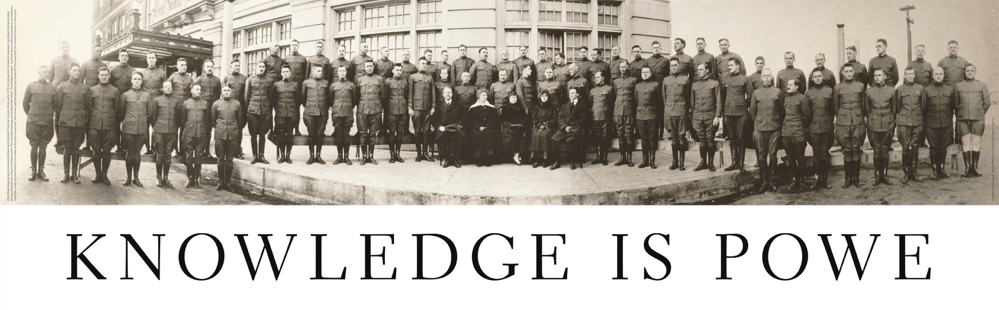
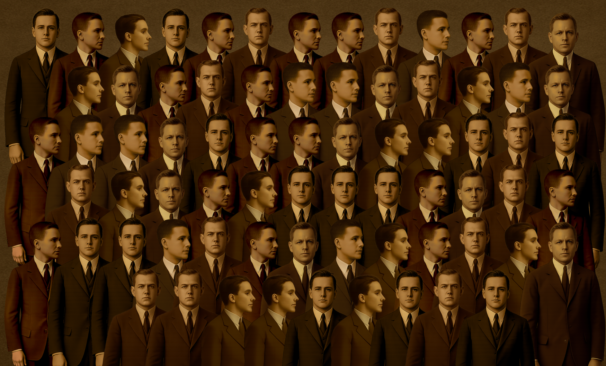

# Bacon Cipher Group Photo

A small web tool for hiding and decoding Bacon cipher messages in a Friedman-inspired group portrait.

The project was inspired by William F. Friedman’s “Knowledge is Power” group photograph, where people facing forward or sideways encode a message using Francis Bacon’s biliteral cipher. A good account of the story is William H. Sherman’s Cabinet article, [“How to Make Anything Signify Anything”](https://www.cabinetmagazine.org/issues/40/sherman.php).

## Try it out
https://odyhibit.github.io/Bacon_cipher_photo/

## What It Does

- `index.html` generates a group image from a secret message or raw binary bits.
- `photo_decoder.html` decodes generated images by matching each figure position against the included front-facing and side-facing figure templates.
  It also works on resized copies of an image: the scale is worked out from the image width and the Columns / Figure Width / Horizontal Overlap settings, so those must still match the generator's settings. Decoding is reliable down to roughly 20% of the original size (JPEG compression at small sizes can flip a few bits, which can be corrected by clicking the faces).
  For raw binary images, enter the exact number of faces, including counts that are not multiples of five. The decoder shows the full bit string and skips message decoding for those counts.
- The `images/` folder contains the bundled figure and background images used by both pages.

In the generated image:

- `0` = front-facing figure
- `1` = side-facing figure
- 5 bits = 1 Bacon cipher letter

## Files

- `index.html` - generator page markup
- `photo_decoder.html` - decoder page markup
- `css/common.css` - shared layout and form styles
- `css/generator.css` and `css/decoder.css` - page-specific styles
- `js/common.js` - shared Bacon alphabet and image loader
- `js/generator.js` and `js/decoder.js` - page-specific behavior
- `bacon_group_composer.py` - original Python image composer
- `images/` - default figures and background

The pages use plain CSS and JavaScript, so there is no build step. Open `index.html`
directly or serve this directory as a static site. Each page loads the shared files
before its own CSS and JavaScript.

## Notes

The current image set is small: three front-facing figures and three side-facing figures.
The generator avoids immediate same-row repeats where possible, but a wider image set would improve variety.
